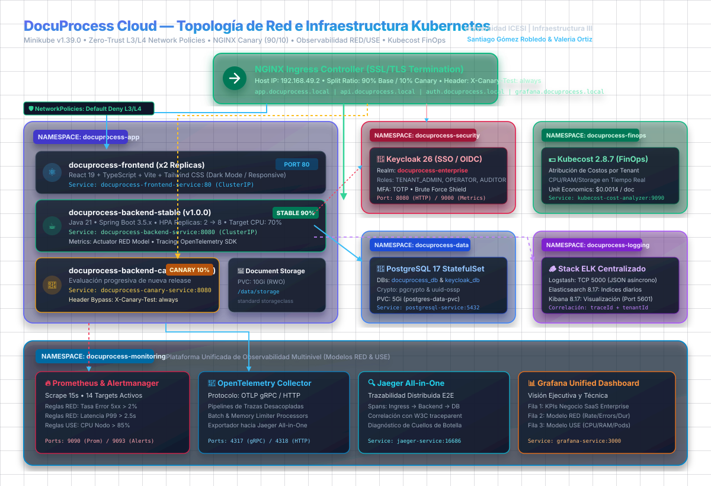

# DocuProcess Cloud — Plataforma SaaS Enterprise
>
> **Universidad ICESI** — Facultad de Ingeniería, Diseño y Ciencias Aplicadas  
> **Curso:** Plataformas II  
> **Integrantes:** Santiago Gómez Robledo &amp; Valeria Ortiz  
> **Entorno:** Kubernetes v1.32.0 (Minikube Engine v1.39.0 sobre Containerd)  
> **Estrategia:** Despliegue Progresivo Canary (NGINX Ingress) • Zero Trust L3/L4 • Observabilidad RED/USE • FinOps (Kubecost)

---

## 1. Descripción de la Plataforma

**DocuProcess Cloud** es una solución de Software as a Service (SaaS) multitenant orientada al procesamiento asíncrono y análisis inteligente de documentos e imágenes corporativas (facturas electrónicas DIAN, contratos legales, documentos de identidad y reportes técnicos).

### Problemática de Negocio Resuelta

En los cierres contables mensuales y temporadas de alta demanda, los clientes enterprise experimentan caídas de servicio causadas por el bloqueo síncrono de hilos HTTP en servidores monolíticos. DocuProcess Cloud solventa esto mediante:

1. **Ingesta Inmediata No Bloqueante:** Retorno en tiempo real de `HTTP 202 Accepted` con UUID de seguimiento (`tracking_id`).
2. **Cómputo Elástico y Desacoplado:** Pools de procesamiento asíncrono gestionados por **Horizontal Pod Autoscaler (HPA v2)** que escalan automáticamente de 2 a 8 réplicas al superar el 70% de utilización de CPU.
3. **Despliegues Progresivos Sin Interrupción:** **Canary Deployments** en el Ingress Controller que dividen el tráfico 90% a la versión estable (`v1.0.0`) y 10% a la versión Canary (`v2.0.0`), mitigando el radio de impacto ante errores.
4. **Seguridad y Cumplimiento Enterprise:** Identidad federada mediante **Keycloak 26** con OpenID Connect (OIDC), control de acceso basado en roles (**RBAC**), autenticación multifactor (**MFA**) y segmentación perimetral **Zero Trust** mediante **Network Policies**.
5. **Observabilidad Holística y FinOps:** Correlación unificada de métricas bajo los modelos **RED** (Rate, Errors, Duration) y **USE** (Utilization, Saturation, Errors), trazabilidad distribuida con **OpenTelemetry/Jaeger**, centralización de logs con el **Stack ELK** y gobernanza económica con **Kubecost**.

---

## 2. Diagrama de Arquitectura del Sistema

A continuación se presenta la topología integral de red y contenedores, dividiendo el **Plano de Control y Observabilidad** del **Plano de Datos**:



---

## 3. Stack Tecnológico

| Capa / Componente | Tecnología | Versión | Rol Arquitectónico |
| :--- | :--- | :--- | :--- |
| **Entorno K8s** | Minikube | v1.39.0 (K8s v1.32) | Clúster local con containerd, Ingress NGINX y metrics-server |
| **Frontend** | React + TypeScript + Vite | React 19 / Vite 6 | SPA responsiva con Dark Mode, animaciones y cliente OIDC |
| **Backend** | Java + Spring Boot | Java 21 / Spring Boot 3.4.3 | Microservicio REST asíncrono con OpenAPI 3 y Micrometer |
| **Base de Datos** | PostgreSQL | 17-alpine | StatefulSet relacional para tareas, metadatos y backend Keycloak |
| **Identidad & SSO** | Keycloak | 26.1.3 (Quarkus) | Servidor OIDC/OAuth2 con MFA (TOTP) y roles RBAC |
| **Centralización Logs** | Stack ELK | 8.17.2 | Elasticsearch (data node), Logstash (pipeline TCP/JSON) y Kibana |
| **Métricas & Alertas** | Prometheus + Alertmanager | Prom v3.2 / Alert v0.28 | Scrape de métricas RED/USE y reglas de latencia $P_{99} > 2.5\text{s}$ |
| **Trazabilidad** | OpenTelemetry + Jaeger | OTel 0.118 / Jaeger 1.64 | Spans distribuidos correlacionados por cabecera W3C `traceparent` |
| **Visualización** | Grafana | 11.5.2 | Dashboard unificado (Negocio, RED, USE, enlaces a Kibana/Jaeger) |
| **Gestión de Costos** | Kubecost | 2.8.7 | Auditoría de Cost of Goods Sold (COGS) por Namespace/Pod |

---

## 4. Matriz de Servicios y Resolución de Nombres Locales

Para acceder a las interfaces desde el navegador del host físico, mapee la IP de Minikube en su archivo `/etc/hosts`:

```bash
# Registrar la IP de Minikube en el host físico:
sudo bash -c "echo '$(minikube ip) app.docuprocess.local api.docuprocess.local auth.docuprocess.local grafana.docuprocess.local kibana.docuprocess.local jaeger.docuprocess.local kubecost.docuprocess.local' >> /etc/hosts"
```

| URL de Acceso | Servicio y Función | Credenciales por Defecto |
| :--- | :--- | :--- |
| `http://app.docuprocess.local` | Portal Web SaaS (React 19) | Autenticación SSO Keycloak |
| `http://api.docuprocess.local/swagger-ui/index.html` | Documentación Swagger / OpenAPI 3 | Acceso Público / Bearer Auth |
| `http://auth.docuprocess.local` | Consola Administrativa Keycloak 26 | `admin` / `DocuAdminSecure2026!` |
| `http://grafana.docuprocess.local` | Grafana Unified Observability Dashboard | `admin` / `DocuGrafanaSecure2026!` |
| `http://kibana.docuprocess.local` | Kibana Log Explorer (ELK) | Acceso directo / Sin contraseña |
| `http://jaeger.docuprocess.local` | Jaeger Distributed Tracing | Acceso directo / Sin contraseña |
| `http://kubecost.docuprocess.local` | Kubecost FinOps Dashboard | Acceso directo / Sin contraseña |

### Usuarios Preconfigurados en Keycloak (`docuprocess-enterprise`)

- **Administrador Empresarial (`TENANT_ADMIN`):** `admin@docuprocess.com` / `AdminPass2026!` (Santiago Gómez Robledo)
- **Operador Operativo (`DOCUMENT_OPERATOR`):** `operator@docuprocess.com` / `OperatorPass2026!` 
- **Auditora de Cumplimiento (`AUDITOR`):** `auditor@docuprocess.com` / `AuditorPass2026!` (Valeria Ortiz)

---

## 5. Guía de Despliegue y Puesta en Marcha

### Prerrequisitos

- Linux con Docker Engine activo.
- Minikube v1.39.0+, `kubectl` y `helm` v3+.
- Recursos mínimos recomendados en el host: 8 vCPUs y 16 GiB RAM.

### 5.1. Inicializar el Clúster Minikube

```bash
minikube start --driver=docker --cpus=8 --memory=14336 --disk-size=40g \
               --addons=ingress,metrics-server,storage-provisioner,default-storageclass
```

### 5.2. Desplegar Infraestructura Base (Namespaces y Almacenamiento)

```bash
kubectl apply -f k8s/base/namespaces/00-namespaces.yaml
kubectl apply -f k8s/base/storage/01-pvcs.yaml
```

### 5.3. Desplegar Base de Datos PostgreSQL 17 y Keycloak 26

```bash
kubectl apply -f k8s/data/
kubectl apply -f k8s/security/
```

### 5.4. Desplegar Stack de Logging ELK y Observabilidad

```bash
kubectl apply -f k8s/logging/
kubectl apply -f k8s/monitoring/
```

### 5.5. Desplegar Kubecost (FinOps)

```bash
helm repo add kubecost https://kubecost.github.io/cost-analyzer/
helm upgrade --install kubecost kubecost/cost-analyzer --version 2.8.7 \
  --namespace docuprocess-finops \
  --set kubecostToken="aWNlc2ktZG9jdXByb2Nlc3MtaW5mcmEzCg==" \
  --set global.prometheus.enabled=true \
  --set networkCosts.enabled=false
```

### 5.6. Compilar Imágenes OCI y Cargar a Minikube

```bash
# Compilar backend versión estable (v1.0.0) y versión canary (v2.0.0)
docker build -t docuprocess-backend:1.0.0 --build-arg APP_VERSION=1.0.0 backend/
docker build -t docuprocess-backend:2.0.0 --build-arg APP_VERSION=2.0.0 backend/

# Compilar frontend React 19
docker build -t docuprocess-frontend:1.0.0 frontend/

# Cargar imágenes al containerd de Minikube
minikube image load docuprocess-backend:1.0.0
minikube image load docuprocess-backend:2.0.0
minikube image load docuprocess-frontend:1.0.0
```

### 5.7. Desplegar Aplicaciones, Políticas de Red, HPA e Ingress

```bash
kubectl apply -f k8s/app/
kubectl apply -f k8s/network-policies/
kubectl apply -f k8s/hpa/
kubectl apply -f k8s/ingress/
```

---

## 6. Scripts de Operación y Validación

El repositorio incluye herramientas automatizadas de auditoría y prueba de estrés:

### 6.1. Auditoría del Definition of Done (DoD 100%)

Evalúa automáticamente los 8 criterios de aceptación exigidos por la Universidad ICESI:

```bash
./scripts/e2e-validate.sh
```

### 6.2. Validación Estadística de Canary Deployment (90/10)

Envía 100 solicitudes HTTP concurrentes hacia `api.docuprocess.local` y calcula el porcentaje de balanceo real:

```bash
./scripts/verify-canary.sh 100
```

Para forzar tráfico hacia Canary mediante cabecera en pruebas de QA:

```bash
curl -H "Host: api.docuprocess.local" -H "X-Canary-Test: always" http://$(minikube ip)/api/v1/documents/version
```

### 6.3. Prueba de Carga y Autoescalado HPA

Inyecta lotes asíncronos concurrentes y ciclos de cómputo para saturar CPU y observar el autoescalado de réplicas en vivo:

```bash
./scripts/test-hpa.sh
```

---

## 7. Procedimiento de Rollback Inmediato ante Fallos

Si la versión Canary (`v2.0.0`) presenta un incremento en la tasa de errores o degradación de latencia ($P_{99} > 2.5\text{s}$):

1. **Retirar Tráfico del Canary:** Establezca `canary-weight: "0"` en el Ingress:

   ```bash
   kubectl annotate ingress -n docuprocess-app docuprocess-api-canary-ingress nginx.ingress.kubernetes.io/canary-weight="0" --overwrite
   ```

2. **Aislar Pods Canary:** Escale a 0 el deployment canary:

   ```bash
   kubectl scale deployment -n docuprocess-app docuprocess-backend-canary --replicas=0
   ```

3. El 100% de las solicitudes será absorbido inmediatamente por `docuprocess-backend-stable` sin indisponibilidad para los clientes.

---

## 8. Apagado y Desmantelamiento del Entorno

Dependiendo del objetivo operativo, seleccione el modo de apagado adecuado:

### Modo A: Apagado Ordenado Conservando Datos (Recomendado entre Sesiones)

Este modo detiene el motor de Minikube de forma limpia mediante señales `SIGTERM`, desacopla los volúmenes sin corrupción, libera el 100% de la CPU (8 vCPUs) y la memoria RAM (14 GiB) del host físico, y **preserva intactos** todos los datos de PostgreSQL, índices de Elasticsearch, configuraciones de Keycloak y dashboards de Grafana:

```bash
# Apagar el clúster de forma limpia y segura
minikube stop
```

Para reanudar el proyecto posteriormente con todos sus datos y servicios tal como quedaron:

```bash
# Encender el clúster (todo se restaura automáticamente en segundos)
minikube start
```

---

### Modo B: Desmantelamiento y Limpieza de Recursos (Teardown Completo)

Si desea eliminar todas las cargas de trabajo desplegadas en Kubernetes respetando el orden topológico inverso de dependencias:

#### Opción 1: Mediante Script Automatizado
```bash
./scripts/teardown.sh
```

#### Opción 2: Ejecución Manual Paso a Paso
```bash
# 1. Eliminar capa de enrutamiento Ingress, HPA y NetworkPolicies
kubectl delete -f k8s/ingress/ --ignore-not-found=true
kubectl delete -f k8s/hpa/ --ignore-not-found=true
kubectl delete -f k8s/network-policies/ --ignore-not-found=true

# 2. Eliminar capa de aplicación (Frontend, Backend Stable y Canary)
kubectl delete -f k8s/app/ --ignore-not-found=true

# 3. Desinstalar release de Kubecost FinOps
helm uninstall kubecost -n docuprocess-finops

# 4. Eliminar observabilidad y logging centralizado (ELK, Prometheus, Grafana, Jaeger)
kubectl delete -f k8s/monitoring/ --ignore-not-found=true
kubectl delete -f k8s/logging/ --ignore-not-found=true

# 5. Eliminar seguridad y persistencia de datos (Keycloak y PostgreSQL)
kubectl delete -f k8s/security/ --ignore-not-found=true
kubectl delete -f k8s/data/ --ignore-not-found=true

# 6. Eliminar volúmenes persistentes (PVCs) y namespaces
kubectl delete -f k8s/base/storage/ --ignore-not-found=true
kubectl delete -f k8s/base/namespaces/ --ignore-not-found=true

# 7. (Opcional) Limpiar entradas DNS en el host físico
sudo sed -i '/docuprocess.local/d' /etc/hosts

# 8. Detener o destruir el clúster Minikube
minikube stop    # Para pausar
# minikube delete  # ¡Cuidado! Destruye la máquina virtual y todos sus datos
```

---

## 9. Documentación Académica y Recursos para la Sustentación

En la carpeta [`docs/`](docs/) se encuentran los entregables detallados para la sustentación ante el docente y compañeros:

- **Presentación Oficial en Canva (15 Diapositivas):** [https://canva.link/ve9c8uf8ocmz5mm](https://canva.link/ve9c8uf8ocmz5mm) *(Edición directa: [canva.com/d/JmcueBf0Uv6Md3z](https://www.canva.com/d/JmcueBf0Uv6Md3z))*.
- **Libreto Diapositiva por Diapositiva (15 Diapositivas):** [`docs/LIBRETO_SUSTENTACION_CANVA.md`](docs/LIBRETO_SUSTENTACION_CANVA.md) (Guion técnico y tiempos calibrados para Santiago Gómez Robledo y Valeria Ortiz).
- **Estructura de Diapositivas (15 Diapositivas):** [`docs/PRESENTATION_SLIDES.md`](docs/PRESENTATION_SLIDES.md) (15 diapositivas completas con caso de negocio, arquitectura, FinOps, SRE y conclusiones).
- **Guion Minuto a Minuto:** [`docs/GUION_EXPOSICION_SANTIAGO_Y_VALERIA.md`](docs/GUION_EXPOSICION_SANTIAGO_Y_VALERIA.md) (Distribución de intervenciones con simulación de preguntas docentes).
- **Runbook Técnico:** [`docs/RUNBOOK.md`](docs/RUNBOOK.md) (Manual de ingeniería y resolución de fallos).
